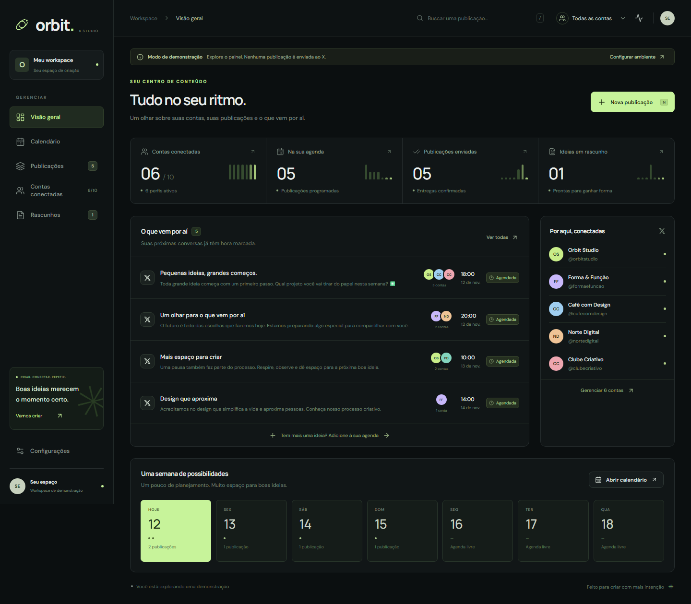

# Orbit — X Studio

Um painel para organizar até **10 contas do X**, escolher em quais publicar e agendar textos e links. Feito com React, Supabase e Playwright. Não usa a API paga do X e aproveita o login do seu sistema principal.

Este guia começa do zero, pensando em quem nunca instalou um projeto. As instruções principais são para **Windows**.



> Siga a **parte 1** para conhecer o painel. A **parte 2** prepara os envios reais. A **parte 3** explica o uso diário. A demonstração não envia nada ao X.

## O que o sistema faz

- Mantém até 10 perfis separados do X.
- Permite selecionar uma conta ou várias e preparar o texto de cada uma.
- Agenda publicações por data, horário e fuso, ou coloca um envio na fila imediatamente.
- Mostra calendário, rascunhos e o resultado de cada conta.
- Permite pausar contas e cancelar envios pendentes.
- Publica texto e links. Esta versão não envia imagens, vídeos ou sequências de posts.

## Entenda as três peças

| Nome neste guia | O que significa |
| --- | --- |
| **Painel** | A página que você abre no navegador para escrever e agendar. |
| **Supabase** | O serviço onde ficam os cadastros, agendamentos e resultados. Use o mesmo projeto do seu sistema principal. |
| **Worker** | Um programa que fica ligado no computador, abre o X pelo Playwright e faz os envios agendados. |

Para publicar de verdade, o worker precisa estar funcionando, com internet e com as contas do X conectadas. Fechar a janela do worker ou desligar o computador interrompe os envios até que ele seja iniciado novamente.

---

## Parte 1 — Baixar e conhecer o painel

### 1. Instale os dois programas necessários

Faça isso uma vez em cada computador:

1. Acesse o [site oficial do Node.js](https://nodejs.org/en/download). Baixe a opção **LTS para Windows**, no formato de instalador `.msi`, e instale. Node.js executa o sistema; o npm vem junto. Use Node.js 22 ou superior.
2. Acesse o [site oficial do Git para Windows](https://git-scm.com/download/win). Baixe e instale. Git baixa uma cópia do projeto e depois permite atualizá-la.
3. Mantenha as opções padrão das instalações. Ao terminar, feche as janelas de terminal que já estavam abertas.

### 2. Abra a janela de comandos

1. Aperte a tecla **Windows**.
2. Digite **PowerShell** e abra **Windows PowerShell** ou **Terminal** com PowerShell.
3. Copie cada linha abaixo, cole nessa janela e pressione **Enter**:

```powershell
node --version
```

```powershell
npm.cmd --version
```

```powershell
git --version
```

Cada comando deve mostrar um número de versão. Se aparecer “não é reconhecido”, feche e reabra o PowerShell depois da instalação. Se ainda não funcionar, reinicie o computador e tente novamente.

**Como usar os próximos blocos:** copie somente o conteúdo de dentro da caixa. Cole uma linha por vez e espere o comando terminar antes de executar o próximo. Quando a instalação termina, a linha para digitar comandos aparece novamente.

Usamos `npm.cmd` e `npx.cmd` para evitar o bloqueio de scripts `.ps1` que algumas instalações do PowerShell possuem. Você não precisa alterar a política de segurança do Windows.

### 3. Baixe uma cópia do projeto — isso se chama “clonar”

O repositório está em:

**[github.com/joaogabriel343/orbit-x-studio](https://github.com/joaogabriel343/orbit-x-studio)**

Ele é privado. Entre na conta GitHub que tem acesso. Se outra pessoa for usar, o dono precisa primeiro convidar a conta dela para o repositório; o link sozinho não libera o acesso.

No PowerShell, execute:

```powershell
New-Item -ItemType Directory -Force -Path "$env:USERPROFILE\Projetos" | Out-Null
```

```powershell
Set-Location "$env:USERPROFILE\Projetos"
```

```powershell
git clone https://github.com/joaogabriel343/orbit-x-studio.git
```

Se o Git pedir acesso ao GitHub, escolha entrar pelo navegador e conclua o login com sua conta. Depois, volte ao PowerShell.

Entre na pasta baixada:

```powershell
Set-Location orbit-x-studio
```

O projeto estará em `Projetos\orbit-x-studio` dentro da sua pasta de usuário do Windows. **Os comandos restantes devem ser executados dentro dessa pasta.**

Se aparecer que `orbit-x-studio` já existe, você provavelmente já clonou. Não precisa clonar novamente: apenas entre na pasta existente.

### 4. Instale os componentes do projeto

```powershell
npm.cmd ci
```

Esse comando baixa os componentes nas versões registradas pelo projeto. Pode levar alguns minutos. Mensagens com `warn` são avisos; uma mensagem com `error` indica que algo precisa ser resolvido antes de continuar.

### 5. Crie o arquivo de configuração

```powershell
if (-not (Test-Path .env)) { Copy-Item .env.example .env }
```

O comando copia um modelo para um arquivo chamado **`.env`**. Se esse arquivo já existe, ele é preservado. Ele guarda as configurações somente neste computador.

Para conhecer a demonstração, não é necessário preencher nenhuma chave.

### 6. Abra o painel

```powershell
npm.cmd run dev
```

Deixe essa janela aberta. Abra o navegador e digite:

**[http://localhost:5173](http://localhost:5173)**

Se o terminal mostrar outra porta, use o endereço informado. Você verá a faixa **Modo de demonstração** e poderá experimentar o editor, o calendário e os rascunhos. As contas e os posts exibidos são exemplos, salvos apenas nesse navegador.

**Para parar:** clique na janela do PowerShell e pressione **Ctrl + C**. Confirme a interrupção se o terminal perguntar.

---

## Parte 2 — Preparar as publicações reais

Faça esta configuração uma vez. Você precisa de acesso ao projeto Supabase já usado pelo seu sistema principal e às contas do X que deseja conectar.

> O Orbit não possui uma tela própria de login. O acesso real vem do sistema React principal, que já autentica o usuário no Supabase. Preencher as chaves não substitui essa sessão; a etapa 11 explica a integração.

### 7. Crie as tabelas no Supabase

1. Acesse o [painel do Supabase](https://supabase.com/dashboard) e abra o projeto correto.
2. No PowerShell, dentro da pasta do projeto, abra o arquivo SQL:

```powershell
notepad .\supabase\migrations\202611120001_x_studio.sql
```

3. No Bloco de Notas, pressione **Ctrl + A** e depois **Ctrl + C** para copiar todo o texto.
4. No Supabase, abra **SQL Editor**, crie uma consulta nova, cole o texto e clique em **Run**.
5. Aguarde a confirmação de sucesso. O arquivo cria as tabelas do Orbit e dez espaços para contas.

Execute esse arquivo uma única vez no mesmo projeto. Se aparecer “relation already exists”, as tabelas podem já ter sido criadas: não apague tabelas para tentar novamente.

Agora libere seu usuário. Em uma **nova consulta** no SQL Editor, cole o código abaixo e troque `seu-email@dominio.com` pelo email com que você já entra no sistema principal:

```sql
insert into public.x_studio_admins(user_id)
select id from auth.users where email = 'seu-email@dominio.com'
on conflict do nothing;
```

Clique em **Run**. Para conferir, execute:

```sql
select user_id from public.x_studio_admins;
```

Deve aparecer uma linha para seu usuário. Se a lista estiver vazia, confira o email e se esse usuário existe em **Authentication > Users** no mesmo projeto. Essa etapa libera um usuário existente; ela não cria um novo login.

Todos os usuários liberados nessa tabela administram as mesmas dez contas desta instalação.

### 8. Preencha o arquivo `.env`

Pare o painel com **Ctrl + C**, se ele estiver aberto, e execute:

```powershell
notepad .env
```

Altere estas linhas, mantendo os nomes à esquerda do sinal `=`:

```dotenv
VITE_DEMO_MODE=false
VITE_SUPABASE_URL=https://SEU-PROJETO.supabase.co
VITE_SUPABASE_PUBLISHABLE_KEY=SUA-CHAVE-PUBLICA
VITE_PARENT_ORIGIN=https://seu-sistema-principal.com
SUPABASE_URL=https://SEU-PROJETO.supabase.co
SUPABASE_SERVICE_ROLE_KEY=SUA-CHAVE-SECRETA
```

Os textos em maiúsculas à direita são exemplos: substitua pelos dados reais.

| Campo | O que colocar |
| --- | --- |
| `VITE_DEMO_MODE` | `false` para usar seu Supabase. `true` volta à demonstração. |
| `VITE_SUPABASE_URL` e `SUPABASE_URL` | A mesma **Project URL** do projeto Supabase. |
| `VITE_SUPABASE_PUBLISHABLE_KEY` | A chave **publishable** ou a chave pública antiga **anon** do projeto. |
| `VITE_PARENT_ORIGIN` | O endereço inicial do sistema principal, incluindo `https://` e a porta, se houver. Não coloque caminho ou barra no final. Por exemplo: `http://localhost:5174`. |
| `SUPABASE_SERVICE_ROLE_KEY` | A chave de servidor do Supabase: uma chave **secret** ou a chave antiga **service_role**. Usada somente pelo worker. |

Você encontra a URL e as chaves na área de conexão/configurações de API do projeto Supabase. A [documentação oficial sobre as chaves](https://supabase.com/docs/guides/getting-started/api-keys) explica onde consultar cada tipo.

Salve com **Ctrl + S** e feche o Bloco de Notas. O arquivo deve continuar chamado `.env`, e não `.env.txt`.

**Atenção ao campo correto:** a chave secreta nunca deve ser colocada em um campo que começa com `VITE_`, porque esses campos ficam públicos no navegador. O `.env` real e as sessões do X não fazem parte do repositório; somente modelos sem credenciais são enviados.

Não é necessário preencher Consumer Key, Bearer Token, senha do X ou outras chaves da API do X.

### 9. Envie a função do painel para o Supabase

Uma “Edge Function” é um pequeno programa que roda dentro do Supabase. Neste projeto, ela confere quem pode acessar o painel e salva os agendamentos. Você enviará o arquivo que já está pronto.

Primeiro, entre na sua conta Supabase pelo terminal:

```powershell
npx.cmd supabase login
```

Se for solicitado instalar o comando `supabase`, confirme com `y` e Enter. Siga o link ou a janela de login mostrada pelo comando e entre na conta com acesso ao projeto.

Depois, informe o código do projeto. Você encontra esse código na URL `https://supabase.com/dashboard/project/CODIGO-DO-PROJETO` ou no início de `https://CODIGO-DO-PROJETO.supabase.co`. Troque o exemplo e execute:

```powershell
$refProjeto = "COLOQUE-O-CODIGO-DO-PROJETO-AQUI"
```

Crie a configuração da função e abra o arquivo:

```powershell
if (-not (Test-Path supabase/functions/.env)) { Copy-Item supabase/functions/.env.example supabase/functions/.env }
```

```powershell
notepad .\supabase\functions\.env
```

No arquivo, deixe `ALLOWED_ORIGINS` com os endereços **de onde o painel Orbit será aberto**. Para começar localmente, use:

```dotenv
ALLOWED_ORIGINS=http://localhost:5173,http://127.0.0.1:5173
```

Se também hospedar o painel, acrescente a origem real, separada por vírgula, sem espaço, caminho ou barra final:

```dotenv
ALLOWED_ORIGINS=http://localhost:5173,http://127.0.0.1:5173,https://painel.seudominio.com
```

Salve e feche. De volta **à mesma janela do PowerShell** onde definiu `$refProjeto`, execute:

```powershell
npx.cmd supabase secrets set --remote=$refProjeto --env-file supabase/functions/.env
```

```powershell
npx.cmd supabase functions deploy x-studio --remote=$refProjeto --no-verify-jwt --use-api
```

Aguarde a confirmação. O envio usa o serviço hospedado do Supabase; não precisa instalar Docker para esses comandos. A opção `--no-verify-jwt` não deixa o painel sem proteção: a função já valida a sessão e a lista de usuários autorizados por conta própria.

Se fechar o PowerShell antes de terminar, digite novamente a linha de `$refProjeto` ao reabrir. Não é necessário executar comandos de criação ou reinicialização do banco.

### 10. Instale o navegador e conecte as contas do X

No computador que fará os envios, execute:

```powershell
npm.cmd run browser:install
```

Espere os downloads terminarem. Isso instala o navegador controlado pelo Playwright, sem precisar baixar outro arquivo manualmente.

Mantenha o worker parado enquanto conecta os perfis. Para a primeira conta:

```powershell
npm.cmd run account:connect -- 1
```

1. Um navegador será aberto.
2. Entre **na conta do X que você quer usar como conta 1**.
3. Complete a verificação de segurança que o próprio X solicitar.
4. Aguarde a página inicial do X aparecer.
5. Volte ao PowerShell e pressione **Enter**.
6. Espere a mensagem `Conta 1 conectada`. O navegador será fechado.

Para adicionar outras contas, repita com um número diferente. Execute uma linha por vez e conclua o login antes de passar à próxima:

```powershell
npm.cmd run account:connect -- 2
npm.cmd run account:connect -- 3
npm.cmd run account:connect -- 4
npm.cmd run account:connect -- 5
npm.cmd run account:connect -- 6
npm.cmd run account:connect -- 7
npm.cmd run account:connect -- 8
npm.cmd run account:connect -- 9
npm.cmd run account:connect -- 10
```

Você não precisa usar os dez espaços. Se tem três contas, conecte apenas 1, 2 e 3. Use um perfil diferente em cada espaço.

Cada sessão fica salva no próprio computador, na pasta `.local`. Ao mudar de computador, conecte as contas novamente. Essa pasta não é enviada ao GitHub. Se um perfil perder a sessão, pare o worker e repita o comando com o número dele.

### 11. Abra pelo sistema principal, usando o login que já existe

Esta integração é feita **uma vez** no sistema React que você já usa. O projeto fornece um modelo pronto em [docs/INTEGRATION.tsx](docs/INTEGRATION.tsx).

A instalação local e o envio da função não acrescentam automaticamente uma tela em outro projeto React. A forma de encaixar essa tela depende de como seu sistema principal está organizado.

O ajuste consiste em usar o componente `OrbitPanel` do arquivo de exemplo numa página do sistema principal, passar a ele o cliente Supabase que o sistema já usa e alterar `PANEL_URL` para o endereço do Orbit. Na instalação local, esse endereço pode ser `http://localhost:5173`. No `.env` do Orbit, `VITE_PARENT_ORIGIN` deve apontar para a origem do sistema principal.

O modelo transmite a sessão, a renovação do acesso e o logout. Ele aproveita o login existente, sem criar outro usuário ou uma nova senha no Orbit.

**Como saber que essa etapa falta:** se o painel mostrar “Abra o painel pelo sistema principal” ou “Aguardando a sessão”, as chaves sozinhas não resolvem; abra a página integrada estando autenticado no sistema principal. O [guia técnico](docs/TECHNICAL.md#integrar-no-sistema-react-principal) detalha o comportamento para quem mantém esse sistema.

---

## Parte 3 — Como usar no dia a dia

### 12. Ligue o painel e o worker

Depois da configuração inicial, não precisa clonar, instalar ou criar as tabelas de novo.

**Primeira janela do PowerShell — painel:**

```powershell
Set-Location "$env:USERPROFILE\Projetos\orbit-x-studio"
npm.cmd run dev
```

**Segunda janela do PowerShell — worker de publicação:**

Abra outra janela do PowerShell, sem fechar a primeira:

```powershell
Set-Location "$env:USERPROFILE\Projetos\orbit-x-studio"
npm.cmd run worker
```

Deixe as duas janelas abertas. O worker normalmente não mostra um navegador porque trabalha em segundo plano. A mensagem `Orbit worker iniciado. Aguardando agendamentos.` indica que o programa iniciou; confira também o status em **Configurações** no painel para confirmar a conexão com o Supabase.

Se o painel estiver hospedado em um servidor, não é necessário rodar `npm.cmd run dev` no seu computador; abra a página hospedada. O worker continua precisando de um computador ou servidor ligado.

### 13. Faça uma publicação

1. Abra o Orbit dentro do sistema principal, após entrar normalmente nele.
2. Acesse **Contas conectadas** e confira os perfis desejados.
3. Clique em **Nova publicação**.
4. Escolha as contas em que deseja publicar.
5. Escreva o texto. O contador mostra o limite do X.
6. Se escolher várias contas, marque **Personalizar o texto por conta** e escreva conteúdo próprio para cada uma. Textos exatamente duplicados entre perfis são bloqueados.
7. Escolha **Agendar**, informe data, horário e fuso, e confirme em **Agendar publicação**. Para envio imediato, escolha **Publicar agora** e adicione à fila.
8. Acompanhe em **Publicações**. Clique em uma publicação para ver o resultado por perfil e o link de um envio confirmado.

O worker consulta a fila a cada 20 segundos por padrão e processa uma conta por vez. “Publicar agora” significa entrar na fila para a próxima execução; não é uma promessa de envio instantâneo. Em um agendamento para várias contas, os perfis podem publicar em momentos diferentes enquanto o navegador processa cada envio.

Para guardar uma ideia sem enviar, use **Salvar rascunho**. Para aproveitar um rascunho ou post existente, abra-o e clique em **Usar como base**; isso prepara uma nova publicação e preserva a original.

### 14. Pause, cancele ou desligue

- **Pausar uma conta:** em **Contas conectadas**, clique em **Pausar conta**. Os envios pendentes aguardam a reativação. Ao reativar, os agendamentos vencidos ficam liberados para envio.
- **Cancelar uma publicação:** abra-a em **Publicações** e clique em **Cancelar pendentes**. Um envio já em andamento pode terminar.
- **Parar o programa:** pressione **Ctrl + C** na janela correspondente. Parar o worker não cancela os agendamentos; os pendentes voltam a ser processados quando ele iniciar novamente.
- **Evitar atrasos:** mantenha o computador do worker ligado, com internet e sem suspensão automática durante os horários de publicação.

---

## Como atualizar depois de uma mudança no GitHub

Pare painel e worker com **Ctrl + C**. Na pasta do projeto:

```powershell
git pull --ff-only
npm.cmd ci
npm.cmd run browser:install
```

Depois, inicie painel e worker como na etapa 12. O `.env` e as sessões locais são preservados porque não fazem parte do Git. Se uma atualização informar nova migration SQL ou nova função, siga as instruções dessa atualização também.

Se o Git avisar sobre alterações locais ou conflito, não use comandos de apagar arquivos ou forçar a atualização. Preserve o que foi alterado e confira a mensagem antes de continuar.

## Problemas comuns e o que fazer

| O que apareceu | O que verificar |
| --- | --- |
| `git`, `node` ou `npm` “não é reconhecido” | Confira a instalação da etapa 1. Feche e reabra o PowerShell; se necessário, reinicie o computador. |
| “Repository not found” ao clonar | O repositório é privado. Entre com a conta que tem acesso ou peça ao proprietário para convidar sua conta. |
| `package.json` não encontrado | O comando foi executado na pasta errada. Use o `Set-Location` da etapa 12. |
| “Não é possível carregar npm.ps1” | Use `npm.cmd` e `npx.cmd`, como neste guia. |
| O endereço do painel não abre | Confira se `npm.cmd run dev` está rodando e use o endereço mostrado no terminal. |
| Ainda aparece “Modo de demonstração” | Salve `VITE_DEMO_MODE=false` no `.env` e reinicie o painel. Se estiver hospedado, gere um novo build. |
| “Aguardando a sessão” ou “Abra o painel pelo sistema principal” | Confira a integração da etapa 11 e entre no sistema principal. Não existe um login separado no Orbit. |
| “Seu usuário não tem acesso a este painel” | Libere o email correto no SQL da etapa 7. O usuário precisa existir no mesmo projeto Supabase. |
| “Origem não autorizada” | Inclua a origem exata do painel em `ALLOWED_ORIGINS` e repita `supabase secrets set` da etapa 9. `localhost` e `127.0.0.1` são origens diferentes. |
| “Configure SUPABASE_URL...” no worker | Preencha os campos do worker no `.env`, salve e reinicie o comando. |
| “Executable doesn't exist” ou navegador não instalado | Execute `npm.cmd run browser:install` dentro da pasta do projeto. |
| Worker sem sinal ou offline | Confira a segunda janela, a internet e as mensagens. Verifique se ela está rodando `npm.cmd run worker`. |
| Conta perdeu a conexão | Pare o worker e reconecte com `npm.cmd run account:connect -- NUMERO`. Depois, inicie o worker novamente. |
| Perfil em uso | Feche o outro processo que esteja usando aquela conta. Para uma interrupção abrupta, consulte os locks no [guia técnico](docs/TECHNICAL.md#preparar-o-worker-playwright). |
| “Conferir no X” | Abra o perfil no X e veja se o post já foi publicado antes de preparar outro envio. Falta de confirmação não significa que o post não saiu. |
| O SQL diz “relation already exists” | A instalação pode já ter sido aplicada. Não exclua tabelas. Confira se está no projeto Supabase correto. |

## Custos, limites e estado desta versão

O código usa Playwright para operar o navegador, sem a API paga do X. Isso não elimina possíveis custos do Supabase, da hospedagem, do computador ou da internet. O X pode restringir automações na interface, pedir verificações ou mudar a página, exigindo manutenção. Respeite as [regras de automação do X](https://help.x.com/en/rules-and-policies/x-automation), incluindo conteúdo duplicado ou muito semelhante entre contas.

Os testes automatizados usam páginas simuladas: não entram em contas e não publicam no X real. Antes de colocar uma agenda importante para funcionar, valide a configuração com suas próprias contas. Esta aplicação foi entregue com testes do banco, da interface e da integração de sessão, além de compilação TypeScript.

Esta instalação compartilha as mesmas contas entre seus operadores autorizados. O painel carrega as 500 campanhas mais recentes. Os detalhes da fila, dos arquivos locais e da hospedagem estão no [guia técnico](docs/TECHNICAL.md).

## Para quem vai manter o código

- [Guia técnico e arquitetura](docs/TECHNICAL.md).
- [Integração com o sistema React principal](docs/INTEGRATION.tsx).
- [SQL de instalação](supabase/migrations/202611120001_x_studio.sql).
- [Modelo de configuração local](.env.example).
- [Modelo de configuração da função Supabase](supabase/functions/.env.example).

```powershell
npm.cmd test
npm.cmd run test:browser
npm.cmd run build
```

No macOS ou Linux, use `npm` e `npx` no lugar de `npm.cmd` e `npx.cmd`; os comandos de pasta e cópia deste passo a passo foram escritos para PowerShell no Windows.
